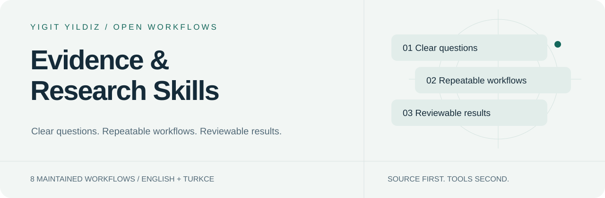

<picture>
  <source media="(prefers-color-scheme: dark)" srcset="assets/hero-dark.svg">
  
</picture>

# Evidence & Research Skills

[English](README.md) · [Türkçe](README.tr.md)

    

**Kaynak temelli araştırma, kanıt değerlendirme, veri analizi ve araştırma sentezi.**

10 bakımı sürdürülen giriş noktası. Göreve göre birini seç; tüm kütüphaneyi bağlama yükleme.

[Başla](docs/INSTALL.md) · [Katalog](https://yigityildiz0.github.io/universal-ai-skill-library/) · [İndirmeler](DOWNLOADS.md) · [Bakım modeli](MAINTAINING.md)

## Bu sürümde yeni (2026.10.14.4)

- **presentation-studio** (yeni): düzenlenebilir PowerPoint sunumu baştan sona — hoca kuralları varsayılan, slayt planı, lisanslı gerçek fotoğraflar, JS ve Python tasarım kitleri, süreli ve okunuşlu konuşmacı notları, PowerPoint render kontrolü, `pptx_audit.py` ve sunum öncesi okuma kılavuzu.
- **pdf-studio** (yeni): güvenilir PDF — önce sorular, tasarım dilleri, baskıya uygun sayfalama (bölünen tablo, yalnız kalan başlık ve taşma yok), denetim ve yapay zekâ PDF hatalarının araştırılmış listesi.
- `slides` artık **html-slides**: yalnız tarayıcı sunumları; PowerPoint istekleri presentation-studio'ya gider.
- academic-study-coach, office-docs-qa, design ve design-system sunum üretimini presentation-studio'ya devreder (kırık PPTX bağlantısı düzeltildi).
- Gemini paketleri (CLI klasörleri ve filtreli Gemini uygulaması yüklemeleri), her uygulama için kurulum tablosu ve SHA-256 özetli gerçek GitHub Release.
- Her uygulama için skill başına tek ZIP, parçalara bölünmez; masaüstü sürümünde Claude için toplu yükleme grupları var.
- Claude.ai yükleme düzeltmesi: büyük skill'ler 200 dosya sınırının altında, iç içe ZIP olmadan TEK skill olarak kalır (yardımcı metin dosyaları INDEX ile resources/bundle-NN.md içinde birleşik).

## Hangi uygulamada?

| Uygulama | Paket |
|---|---|
| Claude Code | taşınabilir klasör → ~/.claude/skills |
| Claude.ai | skill başına bir yükleme ZIP'i |
| Codex / ChatGPT desktop | Codex.zip → ~/.codex/skills |
| ChatGPT web | hesap içe aktarma sunuyorsa eklenti ZIP'i |
| Gemini CLI / app | ~/.gemini/skills · Skills yükleme (filtreli kopya) |
| OpenCode · DeepSeek Harness | taşınabilir klasör + skills yolu |

Ayrıntılı adımlar: [Kurulum](docs/INSTALL.md). Dosyanın diskte olması etkin olduğunu kanıtlamaz; bir örnek istekle dene.

## Yapmak istediğin işi seç

<strong>Günlük işler</strong> · 1

| Skill | Ne işe yarar? |
|---|---|
| [purchase-advisor](docs/skills/purchase-advisor.tr.md) | Reklam sıralaması yerine ürün uygunluğunu, kanıtı ve gerçek toplam maliyeti karşılaştırır. |

<strong>Öğrenme ve yazı</strong> · 3

| Skill | Ne işe yarar? |
|---|---|
| [academic-study-coach](docs/skills/academic-study-coach.tr.md) | Ders içeriğini çalışma planına, aktif hatırlamaya ve literatür okuma pratiğine dönüştürür. |
| [office-docs-qa](docs/skills/office-docs-qa.tr.md) | Belge yapısı, içerik ve görünümü açık doğrulama sınırlarıyla kontrol eder. |
| [pdf-studio](docs/skills/pdf-studio.tr.md) | Güvenilir PDF hazırlar: önce sorular, baskıya uygun HTML/CSS ve tasarım dilleri, sayfa sayfa denetim: bölünen tablo, yalnız kalan başlık, taşma ve bozuk harf. |

<strong>Araştırma ve analiz</strong> · 4

| Skill | Ne işe yarar? |
|---|---|
| [data-analyst](docs/skills/data-analyst.tr.md) | Veriyi birim, eksik değer, varsayım ve belirsizlikleri açık tutarak analiz eder. |
| [parallel-web](docs/skills/parallel-web.tr.md) | Parallel belgelerini korur; bu sürümde ek ücret gerektirmeyen mevcut araştırma araçlarını kullanır. |
| [primary-source-research](docs/skills/primary-source-research.tr.md) | Resmî belge, spesifikasyon, kaynak kodu ve birincil kayıtlardan yanıt üretir. |
| [research-analyst](docs/skills/research-analyst.tr.md) | Hızlı/derin araştırma, iddia doğrulama, sentez ve zaman damgalı video analizini yönlendirir. |

<strong>Tasarım ve üretim</strong> · 1

| Skill | Ne işe yarar? |
|---|---|
| [presentation-studio](docs/skills/presentation-studio.tr.md) | Düzenlenebilir PowerPoint sunumunu baştan sona hazırlar: hoca kuralları varsayılan, slayt planı, lisanslı gerçek fotoğraflar, tasarım kiti, süreli ve okunuşlu konuşmacı notları, render kontrolü ve denetim. |

<strong>Sağlık ve rehabilitasyon</strong> · 1

| Skill | Ne işe yarar? |
|---|---|
| [medical-evidence-research](docs/skills/medical-evidence-research.tr.md) | Rehabilitasyon ve Türkiye uygulanabilirliği dahil tıbbi kanıtı arar, değerlendirir ve sentezler. |

## Bir skill nasıl çalışır?

~~~mermaid
flowchart LR
 A[Your goal] --> B[Match the skill]
 B --> C[Load relevant module]
 C --> D[Use available tools]
 D --> E[Verify and explain]
~~~

Bu bir iş akışıdır; araç çalıştırıldığı veya bütün sonuçların doğrulandığı iddiası değildir. Her skill sayfasında örnek istek, tetikleme, mekanik, girdi/çıktı ve kaynak modüller var.

## Tek kaynak, kalıcı koleksiyonlar

Ana kaynak [Universal AI Skill Library](https://github.com/yigityildiz0/universal-ai-skill-library). Alan depoları aynı sürümün seçilmiş görünümleridir; ayrı ayrı çatallanıp elle düzenlenmez. Mevcut bağlantılar ve geçmiş korunur.

[All collections / Tüm koleksiyonlar](COLLECTIONS.md) · [Legacy/community resources](LEGACY.md) · [Licenses & provenance](docs/LICENSE-SCOPE.md)

## Dürüst kapsam

- Skill kurmak model eğitmek veya hesap/araç bağlamak değildir.
- Yerel dosya ile web hesabına yükleme farklıdır; desteklenen host akışını kullan.
- Ek ücretli API veya model indirme otomatik yapılmaz.
- Eski topluluk kataloğu güncel giriş noktalarının sayısına veya test iddiasına dahil değildir.
- Kaynak lisansları korunur; bütün üçüncü taraf içeriğine tek lisans varsayılmaz.

---
Maintained by [Yigit Yildiz](https://github.com/yigityildiz0) · Source edition 2026.10.14.4
